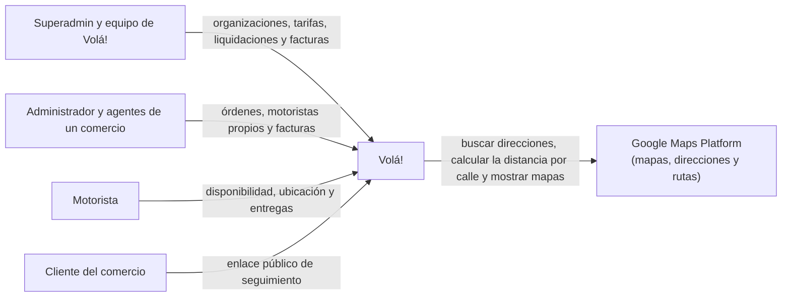
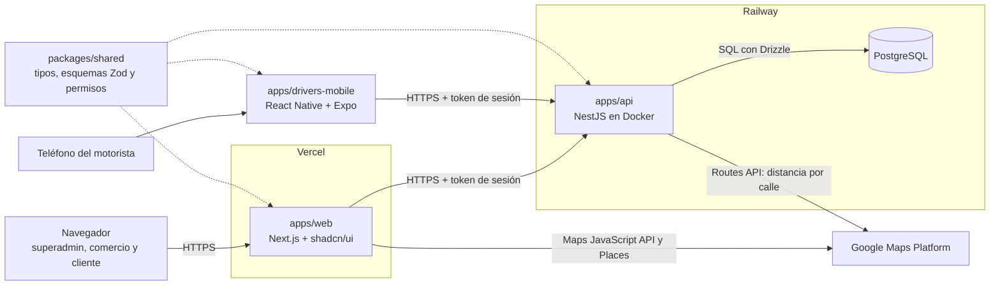
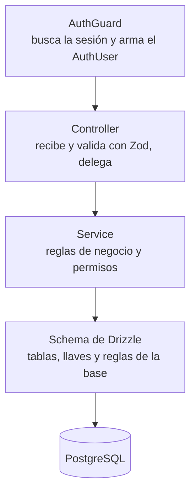
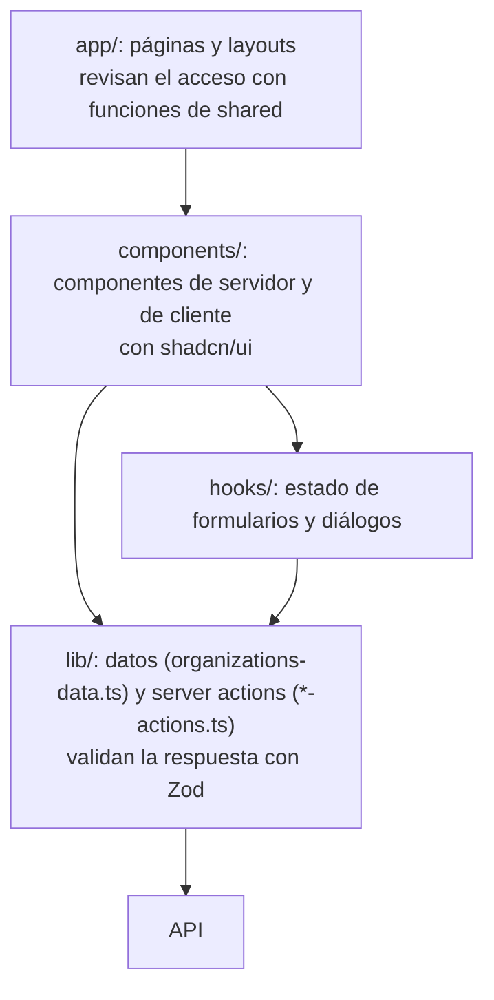
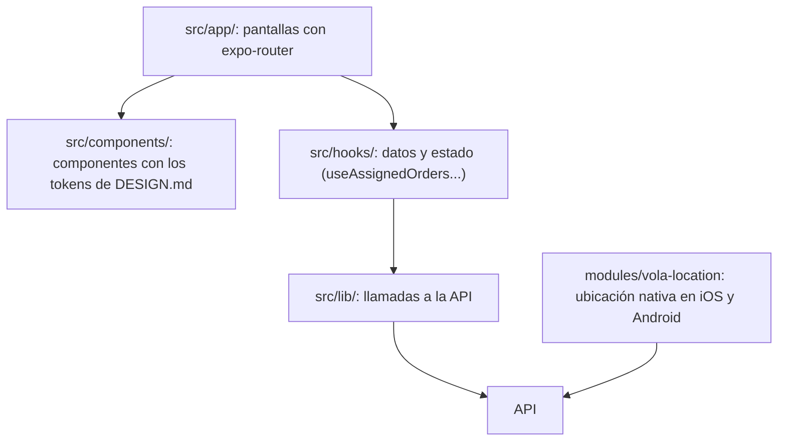

# Arquitectura

## Diagrama de contexto

Quién usa Volá! y con qué sistemas externos habla.



## Diagrama de contenedores



- **apps/web**: panel de Volá! y de los comercios, y la página pública de seguimiento. Los componentes de servidor y las server actions llaman a la API con el token de sesión guardado en una cookie; el navegador nunca habla directo con la API.
- **apps/api**: toda la lógica y las reglas de permisos. Es la única que toca la base de datos.
- **apps/drivers-mobile**: app de motoristas. Guarda el token en `expo-secure-store` comparte la ubicación con un módulo nativo propio (`modules/vola-location`) que sigue funcionando en segundo plano, y muestra los mapas con `react-native-maps`.
- **PostgreSQL**: hay dos bases en Railway, una de desarrollo con la semilla y otra con los datos reales.
- **packages/shared**: se compila a JavaScript sin dependencias de Node ni del DOM, así lo usan las tres apps.

## Capas

### API (NestJS)



- **Guard**: todas las rutas piden sesión salvo las marcadas con `@Public()`: estado de la API, login y seguimiento.
- **Controller**: solo recibe, valida con `ZodValidationPipe` y llama al service.
- **Service**: revisa los permisos con las funciones de `packages/shared` (`canInvoiceMerchants`, `canManageOrders`...) y lanza excepciones de Nest (`ForbiddenException`, `NotFoundException`, `ConflictException`).
- **Schema**: cada módulo define sus tablas en `*.schema.ts`. Las reglas importantes también viven en la base con `CHECK`, llaves foráneas y `UNIQUE`.

### Web (Next.js)



### App de motoristas (Expo)



## Estructura de carpetas

```text
vola/
├── apps/
│   ├── api/
│   │   ├── drizzle/              migraciones SQL generadas por drizzle-kit
│   │   ├── src/
│   │   │   ├── auth/             login, sesiones y guard
│   │   │   ├── organizations/    un módulo por dominio:
│   │   │   ├── merchants/          controller, service(s) y schema
│   │   │   ├── branches/
│   │   │   ├── orders/
│   │   │   ├── drivers/
│   │   │   ├── delivery-fees/
│   │   │   ├── settlements/
│   │   │   ├── invoices/
│   │   │   ├── tracking/
│   │   │   ├── operation-map/
│   │   │   ├── common/           paginación y validación con Zod
│   │   │   └── scripts/          crear superadmin y semilla
│   │   └── test/
│   ├── web/
│   │   ├── app/
│   │   │   ├── (dashboard)/      rutas del panel en español: ordenes, motoristas, mapa,
│   │   │   │                     liquidaciones, facturas, organizaciones
│   │   │   ├── login/
│   │   │   └── seguimiento/      página pública de seguimiento
│   │   ├── components/           un componente por archivo, agrupados por dominio
│   │   │   └── ui/               componentes de shadcn/ui
│   │   ├── hooks/
│   │   └── lib/
│   └── drivers-mobile/
│       ├── src/
│       │   ├── app/              pantallas (expo-router)
│       │   ├── components/
│       │   ├── hooks/
│       │   ├── lib/
│       │   ├── session/
│       │   └── theme/
│       └── modules/vola-location/  módulo nativo de ubicación
├── packages/
│   └── shared/src/               tipos, enums, esquemas Zod y funciones de permisos
├── docs/
│   ├── arquitectura.md
│   ├── decisiones/
│   └── bitacora/
├── Dockerfile                    imagen de la API para Railway
├── CLAUDE.md
└── DESIGN.md
```
