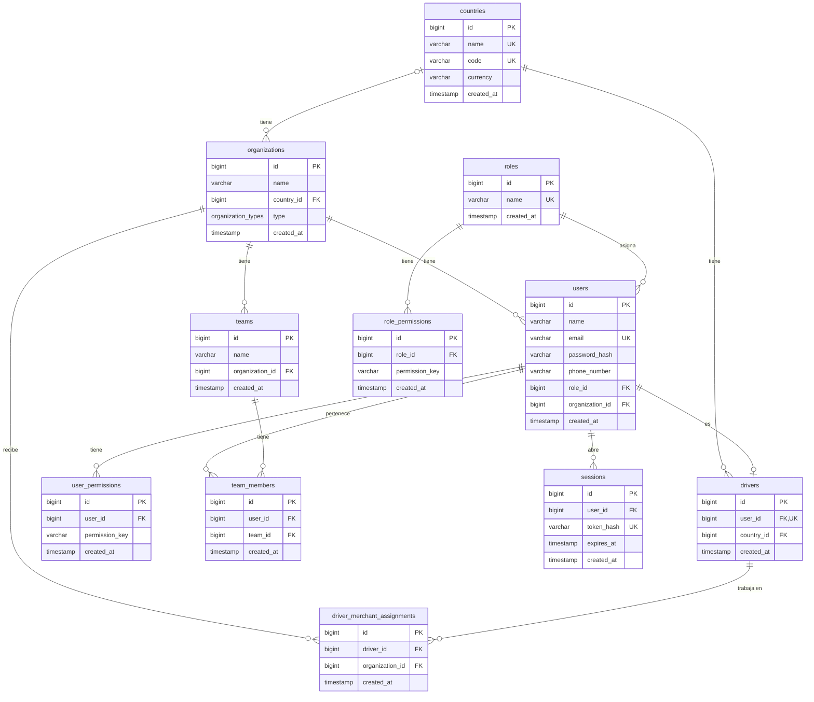

# Modelo de datos

## Diagrama

Relaciones:
- Uno a muchos: un país tiene muchas organizaciones y muchos motoristas; una organización tiene muchos usuarios y equipos; un rol tiene muchos usuarios y permisos; un usuario tiene muchos permisos y sesiones.
- Uno a uno: un usuario puede ser un motorista.
- Muchos a muchos: motoristas y comercios, a través de driver_merchant_assignments; usuarios y equipos, a través de team_members.

## Diccionario de datos

Todas las tablas tienen `id` como llave primaria (bigint generado por la base) y `created_at` NOT NULL con la fecha de creación.

### countries

- Llaves foráneas: ninguna.
- NOT NULL: name, code, currency.
- UNIQUE: name, code.
- CHECK: code son 2 letras mayúsculas (ISO 3166). currency son 3 letras mayúsculas (ISO 4217).

### organizations

- Llaves foráneas: country_id → countries. Al borrar el país: se impide si tiene organizaciones.
- NOT NULL: name, type. country_id puede ser nulo.
- UNIQUE: ninguna.
- CHECK: name no puede estar vacío. type solo puede ser merchant o platform.

### roles

- Llaves foráneas: ninguna.
- NOT NULL: name.
- UNIQUE: name.
- CHECK: name solo puede ser superadmin, administrator, agent o driver.

### role_permissions

- Llaves foráneas: role_id → roles. Al borrar el rol: se borran sus permisos.
- NOT NULL: role_id, permission_key.
- UNIQUE: role_id con permission_key.
- CHECK: ninguno.

### users

- Llaves foráneas: role_id → roles y organization_id → organizations. Al borrar el rol o la organización: se impide si tiene usuarios.
- NOT NULL: name, email, password_hash, phone_number, role_id, organization_id.
- UNIQUE: email.
- CHECK: name y phone_number no pueden estar vacíos. email tiene que estar en minúsculas.

### user_permissions

- Llaves foráneas: user_id → users. Al borrar el usuario: se borran sus permisos.
- NOT NULL: user_id, permission_key.
- UNIQUE: user_id con permission_key.
- CHECK: ninguno.

### drivers

- Llaves foráneas: user_id → users y country_id → countries. Al borrar el usuario: se borra el motorista. Al borrar el país: se impide si tiene motoristas.
- NOT NULL: user_id, country_id.
- UNIQUE: user_id.
- CHECK: ninguno.

### driver_merchant_assignments

- Llaves foráneas: driver_id → drivers y organization_id → organizations. Al borrar el motorista o la organización: se borran sus asignaciones.
- NOT NULL: driver_id, organization_id.
- UNIQUE: driver_id con organization_id.
- CHECK: ninguno.

### teams

- Llaves foráneas: organization_id → organizations. Al borrar la organización: se borran sus equipos.
- NOT NULL: name, organization_id.
- UNIQUE: organization_id con name.
- CHECK: name no puede estar vacío.

### team_members

- Llaves foráneas: user_id → users y team_id → teams. Al borrar el usuario o el equipo: se borra la membresía.
- NOT NULL: user_id, team_id.
- UNIQUE: team_id con user_id.
- CHECK: ninguno.

### sessions

- Llaves foráneas: user_id → users. Al borrar el usuario: se borran sus sesiones.
- NOT NULL: user_id, token_hash, expires_at.
- UNIQUE: token_hash.
- CHECK: expires_at tiene que ser posterior a created_at.
