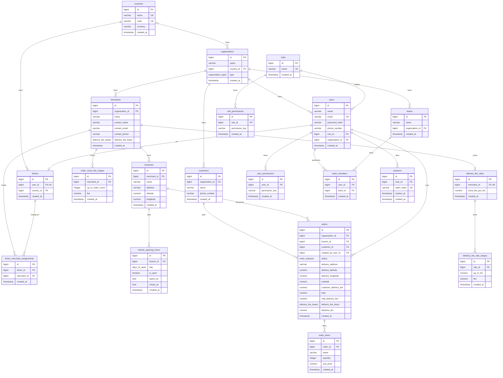

# Modelo de datos

## Diagrama

Relaciones:
- Uno a muchos: un país tiene muchas organizaciones y muchos motoristas; una organización tiene muchos usuarios, equipos y comercios; un rol tiene muchos usuarios y permisos; un usuario tiene muchos permisos y sesiones; una tarifa de envío tiene muchos rangos; un comercio tiene muchos rangos de tarifa por cantidad de pedidos y muchas sucursales; una sucursal tiene un horario por cada día de la semana; una organización tiene muchos clientes; un cliente, una sucursal y un usuario tienen muchos pedidos; un pedido tiene muchos productos.
- Uno a uno: un usuario puede ser un motorista; un comercio puede tener una tarifa de envío.
- Muchos a muchos: motoristas y comercios, a través de driver_merchant_assignments (un motorista atiende uno o más comercios); usuarios y equipos, a través de team_members.

## Diccionario de datos

Todas las tablas tienen `id` como llave primaria (bigint generado por la base) y `created_at` NOT NULL con la fecha de creación.

### countries

- Llaves foráneas: ninguna.
- NOT NULL: name, code, currency.
- UNIQUE: name, code.
- CHECK: code son 2 letras mayúsculas (ISO 3166). currency son 3 letras mayúsculas (ISO 4217).

### organizations

- Llaves foráneas: country_id → countries. Al borrar el país: se impide si tiene organizaciones.
- NOT NULL: name, type. country_id puede ser nulo.
- UNIQUE: ninguna.
- CHECK: name no puede estar vacío. type solo puede ser merchant (un cliente) o platform (solo Volá!).

### roles

- Llaves foráneas: ninguna.
- NOT NULL: name.
- UNIQUE: name.
- CHECK: name solo puede ser superadmin, administrator, agent o driver.

### role_permissions

- Llaves foráneas: role_id → roles. Al borrar el rol: se borran sus permisos.
- NOT NULL: role_id, permission_key.
- UNIQUE: role_id con permission_key.
- CHECK: permission_key solo puede ser organizations.view, delivery_fees.manage, merchants.manage, orders.create o drivers.manage.

### users

- Llaves foráneas: role_id → roles y organization_id → organizations. Al borrar el rol o la organización: se impide si tiene usuarios.
- NOT NULL: name, email, password_hash, phone_number, role_id, organization_id.
- UNIQUE: email.
- CHECK: name y phone_number no pueden estar vacíos. email tiene que estar en minúsculas.

### user_permissions

- Llaves foráneas: user_id → users. Al borrar el usuario: se borran sus permisos.
- NOT NULL: user_id, permission_key.
- UNIQUE: user_id con permission_key.
- CHECK: permission_key solo puede ser organizations.view, delivery_fees.manage, merchants.manage, orders.create o drivers.manage.

### drivers

- Llaves foráneas: user_id → users y country_id → countries. Al borrar el usuario: se borra el motorista. Al borrar el país: se impide si tiene motoristas.
- NOT NULL: user_id, country_id.
- UNIQUE: user_id.
- CHECK: ninguno.

### driver_merchant_assignments

- Llaves foráneas: driver_id → drivers y merchant_id → merchants. Al borrar el motorista o el comercio: se borran sus asignaciones.
- NOT NULL: driver_id, merchant_id.
- UNIQUE: driver_id con merchant_id.
- CHECK: ninguno.

### teams

- Llaves foráneas: organization_id → organizations. Al borrar la organización: se borran sus equipos.
- NOT NULL: name, organization_id.
- UNIQUE: organization_id con name.
- CHECK: name no puede estar vacío.

### team_members

- Llaves foráneas: user_id → users y team_id → teams. Al borrar el usuario o el equipo: se borra la membresía.
- NOT NULL: user_id, team_id.
- UNIQUE: team_id con user_id.
- CHECK: ninguno.

### merchants

- Llaves foráneas: organization_id → organizations. Al borrar la organización: se borran sus comercios.
- NOT NULL: organization_id, name, contact_name, contact_email, contact_phone. delivery_fee_basis puede ser nulo: el comercio todavía no eligió cómo cobra el envío.
- UNIQUE: organization_id con name.
- CHECK: name, contact_name y contact_phone no pueden estar vacíos. contact_email tiene que estar en minúsculas. delivery_fee_basis solo puede ser distance o completed_orders.

### delivery_fee_rates

- Llaves foráneas: merchant_id → merchants. Al borrar el comercio: se borra su tarifa.
- NOT NULL: merchant_id. extra_fee_per_km puede ser nulo: sin cobro por km extra, el último rango no tiene límite.
- UNIQUE: merchant_id.
- CHECK: extra_fee_per_km no puede ser negativo.

### delivery_fee_rate_ranges

- Llaves foráneas: rate_id → delivery_fee_rates. Al borrar la tarifa: se borran sus rangos.
- NOT NULL: rate_id, fee. up_to_km puede ser nulo: es el último rango, sin límite de km.
- UNIQUE: rate_id con up_to_km, contando los nulos como iguales (solo un rango sin límite por tarifa).
- CHECK: up_to_km mayor que 0. fee no puede ser negativo.

### order_count_fee_ranges

- Llaves foráneas: merchant_id → merchants. Al borrar el comercio: se borran sus rangos.
- NOT NULL: merchant_id, fee. up_to_order_count puede ser nulo: es el último rango, cubre todos los pedidos que siguen en el mes.
- UNIQUE: merchant_id con up_to_order_count, contando los nulos como iguales (solo un rango sin límite por comercio).
- CHECK: up_to_order_count mayor que 0. fee no puede ser negativo.

### branches

- Llaves foráneas: merchant_id → merchants. Al borrar el comercio: se borran sus sucursales.
- NOT NULL: merchant_id, name, address, latitude, longitude.
- UNIQUE: merchant_id con name.
- CHECK: name y address no pueden estar vacíos. latitude va de -90 a 90 y longitude de -180 a 180.

### branch_opening_hours

- Llaves foráneas: branch_id → branches. Al borrar la sucursal: se borra su horario.
- NOT NULL: branch_id, day, is_open. opens_at y closes_at pueden ser nulos: un día cerrado no lleva horas.
- UNIQUE: branch_id con day.
- CHECK: day solo puede ser un día de lunes a domingo. Un día abierto lleva opens_at y closes_at, con closes_at después de opens_at; un día cerrado no lleva ninguna de las dos.

### customers

- Llaves foráneas: organization_id → organizations. Al borrar la organización: se borran sus clientes.
- NOT NULL: organization_id, name, phone_number.
- UNIQUE: organization_id con phone_number. Un cliente se reconoce por su teléfono dentro de la organización.
- CHECK: name y phone_number no pueden estar vacíos.

### orders

- Llaves foráneas: organization_id → organizations, branch_id → branches, customer_id → customers y created_by_user_id → users. Al borrar cualquiera de ellos: se impide si tiene pedidos.
- NOT NULL: todo menos distance_km, que solo se llena cuando el costo de Volá! se calculó por distancia.
- UNIQUE: ninguna.
- CHECK: status solo puede ser new, preparing, on_the_way, delivered o cancelled. delivery_address no puede estar vacía. Los montos no pueden ser negativos. total es subtotal más customer_delivery_fee.

### order_items

- Llaves foráneas: order_id → orders. Al borrar el pedido: se borran sus productos.
- NOT NULL: order_id, name, quantity, unit_price.
- UNIQUE: ninguna.
- CHECK: name no puede estar vacío. quantity mayor que 0. unit_price no puede ser negativo.

### sessions

- Llaves foráneas: user_id → users. Al borrar el usuario: se borran sus sesiones.
- NOT NULL: user_id, token_hash, expires_at.
- UNIQUE: token_hash.
- CHECK: expires_at tiene que ser posterior a created_at.
